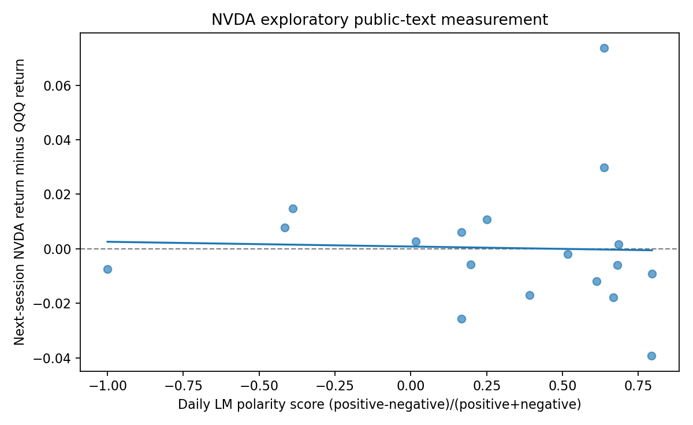

# News2Market

**An extensible, company-aware financial news research workbench**  
*Python web scraping · structured research datasets · financial NLP · exploratory empirical analysis*

News2Market converts company-related announcements and third-party financial reporting into **auditable, firm-specific text measures**. Users select a U.S.-listed company in a **local, English-language dashboard**; the same pipeline discovers relevant news, extracts permitted article bodies, calculates Loughran–McDonald financial text features and links them to historical market data for exploratory analysis.

The architecture is designed for wider U.S. equity coverage. Given the computing and data-access constraints of an independently developed project, the current tested scope is **NVIDIA (`NVDA`), Apple (`AAPL`) and Alphabet (`GOOGL`)**, using **QQQ** as the market benchmark. Expansion requires additional source adapters, authorized data access and independent validation; arbitrary U.S. stocks are not supported by the current release.

> **Research status:** Working local engineering prototype; **not** a validated stock-price predictor, causal event study, production crawler or investment recommendation.

## Research Motivation and Technical Contributions

**Research question:** How can nontraditional financial text be collected, transformed into replicable economic measures, and evaluated against subsequent market outcomes without confusing textual tone with an economic shock?

| Research skill | Concrete implementation |
|---|---|
| **Company-aware web scraping and nontraditional data collection** | Configurable company profiles and shared news discovery across issuer websites/RSS and third-party feeds; company-name/alias filters, duplicate removal, full-text extraction where permitted, source access/error logs. |
| **Constructing novel research datasets** | Transforms HTML/RSS into ticker-labeled article-level records with headlines, publisher URLs, date-quality flags, text quality controls and run-specific provenance. Joins measurements to the selected company's dated stock/QQQ series. |
| **Python NLP / AI-assisted economic measurement** | Official Loughran–McDonald lexicon counts and per-1,000-word positive/negative/uncertainty rates; interpretable but **unvalidated** polarity score; optional locally served Ollama/Qwen2.5 1.5B event-labeling and evidence audit. |
| **Statistical research and diagnostic analysis** | News/date alignment, Pearson correlations, HC1 OLS, exploratory price-return differences, plots, sparse-token and text-cleaning checks; preserves missing labels, model failures and non-significant results. |
| **Research documentation and communication** | Reproducibility instructions, transparent variable definitions, source audits, limitations, and an empirical [research report](docs/RESEARCH_REPORT.md) rather than unsupported prediction claims. |

**Not claimed:** OCR, training or fine-tuning an NLP model, structural/dynamic economic modeling, randomized experiments, or independent large-scale human labeling. The current analysis is observational, and the historical NVIDIA pilot does not validate the other two firms.

## Quick Start — Five Steps

**Requirements:** macOS/Linux, Python **3.11 or 3.12** (recommended), an official LM dictionary, and legitimate Nasdaq historical CSVs for the **selected stock and QQQ**. The repository does **not** redistribute these third-party inputs. An internet connection is needed to discover new news.

### Step 1 — Clone and install

```bash
git clone https://github.com/RichardFranklinBAO/News2Market.git
cd News2Market
python3 -m venv .venv
source .venv/bin/activate
python -m pip install --upgrade pip
python -m pip install -r requirements.txt
```

Alternatively select **Code → Download ZIP** on GitHub, extract it and run the installation commands inside the extracted folder. A **private** repository requires the owner's authorization; external reviewers can clone after it is made public or they are granted access.

### Step 2 — Install the official LM financial dictionary

Download the **Loughran–McDonald Master Dictionary, 1993–2025** from [Notre Dame SRAF](https://sraf.nd.edu/loughranmcdonald-master-dictionary/). Save it under this exact filename and path:

```text
Inputs/Loughran-McDonald_MasterDictionary_1993-2025.csv
```

The app checks that the file is valid **before** starting the research run. For users who already have a separately installed `News2Market` project, it may validate and reuse that local copy. **No synthetic dictionary is substituted.**

### Step 3 — Verify code integrity

```bash
python -m unittest discover -s tests -v
```

The research and application test suite currently defines **49 offline test cases** (15 application tests, 13 original research tests, and 21 data-integrity tests). The prior **31 research tests** passed in the local safeguard release check; the three new measurement-boundary tests require CI confirmation. the 15 application tests are included in the GitHub Actions workflow and need independent CI confirmation. Data-dependent tests may be skipped if the official LM dictionary is not locally installed. Offline fixtures **do not verify live SEC/news availability or financial predictive accuracy**.

### Step 4 — Launch the English dashboard and import Nasdaq CSVs

```bash
python -m news2market --web
# If port 8765 is already occupied:
# python -m news2market --web --port 8766
```

Open **http://127.0.0.1:8765** (or port 8766). Select NVIDIA, Apple or Alphabet/Google. Under **Nasdaq Historical Data**, import (a) the selected company's official daily CSV and (b) the benchmark **QQQ** CSV, each with `Date` and `Close/Last` columns. Confirm the downloaded files' identities and sources; Nasdaq raw CSV exports do not include a ticker identifier. Both price datasets and the LM dictionary should show **Ready**. Files are imported once and then locally reused.

**Important:** This application **does not automatically scrape or download from Nasdaq.com**, and it does not use Yahoo Finance/yfinance. Download from the official Nasdaq historical-data pages below under the provider's terms, then import through the dashboard. Automatic acquisition would require a separately authorized provider API.

### Step 5 — Run and inspect the research outputs

Select a news window (e.g., **30 days**), a price horizon (e.g., **5 years**), and a maximum article count (e.g., **10**), then click **Run research**. Keep optional local Qwen inference **off** for the first check. Inspect the dashboard's source audit, article count, lexicon scores and any exploratory return diagnostics.

Each run saves independent outputs under:

```text
Results/<TICKER>/Runs/<UTC_RUN_ID>/
├── research_report.json   # Overall run status, warnings and results
├── news_summary.csv       # Article-level text measurements
├── 05_lm_labels.csv       # LM dictionary word counts and polarity
├── 07_prices.csv          # Date-aligned stock/benchmark prices
└── 07_price_audit.json    # Price provenance and coverage
```

A report may show **zero articles** when feeds or publisher pages are inaccessible; a regression may be **not estimated** when article dates or later prices are insufficient. Do not mistake these documented limitations for successful prediction. See [Reproducibility](docs/REPRODUCIBILITY.md) for verification rules.

## What the Software Does

The web UI calls **one shared research pipeline** (`core.run_pipeline`), not three unrelated company scripts. Company-specific names, tickers, feeds and aliases are configuration rather than replicated scraping logic.

| Company | Configured issuer source | Other news discovery |
|---|---|---|
| **NVIDIA (NVDA)** | [NVIDIA Newsroom](https://nvidianews.nvidia.com/) HTML collector | Search and publisher RSS including TechCrunch, CNBC Tech and Ars Technica |
| **Apple (AAPL)** | [Apple Newsroom RSS](https://www.apple.com/newsroom/rss-feed.rss) | Same external discovery, using Apple/AAPL/iPhone-related aliases |
| **Alphabet (GOOGL)** | [Google Blog RSS](https://blog.google/rss/) | Same external discovery, using Google/Alphabet/GOOGL-related aliases |

Company/name filters are heuristic and require manual inspection for ambiguous matches. Feeds may be unavailable or inaccessible. **Complete live end-to-end collection has not been independently validated for all three firms**. For new issuers, add verified profiles and authorized news sources, then test company resolution and text quality.

**Pipeline:** selected company → source discovery / access audits → permitted publisher text extraction → source normalization and deduplication → documented LM measures → dated stock/QQQ pairing → optional Qwen annotation → exploratory statistics and quality audit.

**Stack:** Python, `requests`, BeautifulSoup, `trafilatura`, XML/RSS parsing, `pandas`, NumPy, `statsmodels` (HC1 OLS), Matplotlib, JSON/CSV outputs, `PyYAML` configuration, and optional local [Ollama](https://ollama.com/) with **`qwen2.5:1.5b`**. No paid LLM API, cloud model, hosted dashboard or user account is required.

## Optional Local LLM Experiment and Future Model APIs

**What Ollama does:** [Ollama](https://ollama.com/) is a **local model-serving runtime**, not the language model itself. In this pilot, Ollama runs the pretrained **Qwen2.5 1.5B** model on a personal Mac. After the pipeline extracts a news article, the optional LLM stage asks Qwen to suggest **(i) sentiment direction and score, (ii) an economic event type, (iii) a possible economic transmission channel, and (iv) an evidence ID tied to a source-text excerpt**. The Python code checks output structure, permissible values and evidence links. These are **experimental annotations**, not independently validated economic interpretations or causal effects.

**Why it is optional:** The core workflow—company-aware news discovery, permitted full-text extraction, Loughran–McDonald (LM) lexicon measurement, Nasdaq/QQQ data alignment and exploratory statistical analysis—**works without Ollama**. Ollama/Qwen adds a separate attempt at **context-aware economic event labeling** beyond simple word counts. Given the limited compute available during independent development, 1.5B was chosen as a **resource-constrained proof of concept**, not a claim of optimal accuracy. In the 30-article NVIDIA audit, only **9** outputs passed structural/evidence checks, **3** needed review and **18** failed. Even a structurally valid label may be economically incorrect; these labels are not validated market predictors.

**Optional local setup (not required for the five-step Quick Start):**

```bash
# Install Ollama separately from https://ollama.com/download, then:
ollama pull qwen2.5:1.5b
python -m news2market --web
```

Enable **Local LLM** in the dashboard only after Ollama is installed and the model has been pulled. No paid API key is needed for this local mode. The repository **does not download Ollama or ship model weights**.

**Potential future extension — hosted model APIs:** With appropriate funding, permitted data access and independent benchmarks, the architecture could support an **OpenAI API** adapter (or other hosted LLM services) in addition to Ollama. That would permit comparison of more capable models on event classification, economic-channel interpretation, evidence faithfulness, output validity and inference cost. **This is a proposed extension only: no OpenAI API integration, paid model calls or cross-model accuracy comparison is implemented or reported.** Hosted inference would introduce API charges and require reviewing news-text licensing, data-sharing/privacy requirements and reproducibility. Larger or hosted models **might** improve annotation quality, but improvement must be demonstrated against independently reviewed labels rather than assumed.

## Optional Research Extension — SEC Disclosures and Text Evaluation

The optional **research** command extends the three-company pipeline with a provenance-first **SEC EDGAR 8-K / 10-Q / 10-K dataset**, official Loughran–McDonald text features, and descriptive TF-IDF vocabulary measures. It can read saved News2Market news CSVs alongside company-specific filings, with stable document identifiers, sources, dates, hashes, deduplication and missing-data audits. **The original English dashboard and `python -m news2market --web` remain unchanged.**

```bash
# View the separate optional research commands
python -m news2market research --help

# Request SEC metadata with YOUR real name/contact in the SEC User-Agent
export N2M_SEC_USER_AGENT='Your Name your-real-email@example.com'
python -m news2market research sec --ticker NVDA \
  --start 2025-01-01 --end 2026-11-05 --max-filings 10

# Optional: also retrieve permitted primary HTML filings and measure text
python -m news2market research sec --ticker NVDA \
  --start 2025-01-01 --end 2026-11-05 --max-filings 5 --fetch-bodies

# Or re-measure an already captured local article CSV, with no web access
python -m news2market research measure --ticker NVDA \
  --input-csv path/to/saved_articles.csv
```

**Research safeguards:** SEC access identifies the user, throttles requests and stops on 403/429; the local results folder is excluded from GitHub. TF-IDF is **not sentiment by itself**, and this update **does not reproduce XLex's RoBERTa/SHAP lexicon construction or benchmark pretrained transformers**. A chronological TF-IDF-versus-LM comparison is available **only if the user supplies sufficient independently annotated human sentiment labels**; the existing AI-assisted labels do not count as such ground truth. No significant market prediction or out-of-sample improvement is claimed.

**Data-integrity safeguards:** Metadata-only, short, or truncated filing bodies are retained for provenance but **excluded from LM and TF-IDF scoring**; the research LM and TF-IDF workflows share a **240,000-character full-body limit**, so a 200,001–240,000-character complete filing is analyzed in full, while oversized imported texts are excluded rather than silently rescored on a subset; the research scorer uses complete document bodies rather than SEC filing titles. Imported CSV records are checked against the selected issuer's ticker, CIK, SEC URL CIK or explicitly disclosed heuristic title/issuer-host evidence, and conflicts are excluded with an identity audit. SEC mode writes `sec_collection_audit.json` and `sec_data_quality_report.md` with completeness and truncation counts. The default 1.5 MB / 240,000-character limits may exclude large 10-Ks. **Live SEC retrieval and event-time validity have not been validated in this release.**

**Methods, required inputs, responsible access and limitations:** [Financial Text Research Extension](docs/FINANCIAL_TEXT_RESEARCH.md). The research extension is independent from the existing stock-price/QQQ exploratory analysis, and time-of-first-market-availability is not verified for SEC filing documents.

## Data Sources and Measurement Definitions

| Input | Official source | Pilot / version |
|---|---|---|
| `NVDA` daily prices | [Nasdaq NVDA](https://www.nasdaq.com/market-activity/stocks/nvda/historical) | **2021-11-05 through 2026-11-04** |
| `QQQ` daily benchmark | [Nasdaq QQQ](https://www.nasdaq.com/market-activity/etf/qqq/historical) | Same dates; **1,254 matched sessions** with NVDA |
| `AAPL` prices | [Nasdaq AAPL](https://www.nasdaq.com/market-activity/stocks/aapl/historical) | User-selected period; not part of the original historical regression |
| `GOOGL` prices | [Nasdaq GOOGL](https://www.nasdaq.com/market-activity/stocks/googl/historical) | User-selected period; not part of the original historical regression |
| LM financial dictionary | [Notre Dame SRAF](https://sraf.nd.edu/loughranmcdonald-master-dictionary/) | `Loughran-McDonald_MasterDictionary_1993-2025.csv` |

**Historical research windows are different:** The original NVIDIA Newsroom study used a configured window of **2026-08-01 through 2026-11-04** (30 captured articles), while the prices covered five years. The historical regression was computed on **18 dated signal days**, not 1,254 independent news observations.

For a document with LM-positive count \(P_i\), LM-negative count \(N_i\), uncertainty count \(U_i\), and total eligible tokens \(W_i\), the pipeline reports interpretable text frequencies \(1000P_i/W_i\), \(1000N_i/W_i\), and \(1000U_i/W_i\), as well as the project's secondary polarity index \((P_i-N_i)/(P_i+N_i)\). When there are no polarity hits, the polarity is treated as **missing**, not as economically neutral. The index's ±0.15 category thresholds are project heuristics, **not literature-validated financial-shock thresholds**. A positive news tone does not imply a positive stock return.

Nasdaq `Close/Last` is **not adjusted for cash dividends** and may involve provider-specific split treatment; the project reports exploratory **price-return** differences relative to QQQ, **not** total returns or factor-adjusted abnormal returns. Date-only news records cannot establish intraday first-availability times and therefore do not support same-day causal claims.

## Observed Results — Historical NVIDIA Pilot

The preserved NVIDIA-only pilot used **30 issuer announcements**, 29 with LM polarity hits, and **18** market-aligned signal days. The Pearson correlation between daily LM polarity and the following NVDA-minus-QQQ price-return measure was **−0.0353**; exploratory HC1 OLS yielded **β = −0.001736**, **p ≈ 0.8602**, **R² ≈ 0.00125**. **No statistically significant association was demonstrated.**

The local Ollama/Qwen2.5 1.5B pilot on those 30 texts had **9 structurally/evidence-valid outputs**, **3 manual-review cases** and **18 failures**. This does not measure semantic accuracy against independently blinded human truth. A separate two-article TechCrunch/CNBC RSS trial successfully extracted and scored both full texts but does **not** establish reliable historical coverage or return impact.



See the full [Research Report](docs/RESEARCH_REPORT.md) and [reproducibility guide](docs/REPRODUCIBILITY.md).

## Limitations and Resource-Constrained Development

This project was built **independently on a personal Mac**, using public and free-access research tools rather than institutional computing infrastructure, licensed feeds or a large human annotation team. The currently available data and model capacity explain the **small pilot scope** but do **not validate** the measurements or excuse weak empirical evidence.

* **Data access:** Nasdaq prices require user-provided authorized CSVs; the LM dictionary must be obtained from Notre Dame under its terms. RSS and publisher access may change, and the project respects 403/429 responses, access controls and robots restrictions.
* **Company/news coverage:** Current source mappings and heuristic entity filters support three selected issuers; they are neither a complete news archive nor a fully validated market-wide entity resolution system.
* **Local model:** Qwen2.5 1.5B was chosen to fit limited personal compute (approximately 5 GB available during development), not because its labels outperform larger models. Structured outputs can still be semantically invalid.
* **Financial measurement:** LM was designed for financial disclosures, not necessarily editorial stories; sparse word matches, disclaimers and differing issuer/publisher styles create measurement concerns. The polarity index and categories require independent evaluation.
* **Empirical scope:** Publication timestamps are not verified intraday; raw price returns omit cash dividends; the pilot has few independent signal days, exploratory HC1 inference and no holdout, factor adjustment or causal identification. Results are **not trading signals**.
* **Software maturity:** Offline integration tests confirm core pipeline routing, not universal feed uptime. The local dashboard is not hardened as a public Internet service. All-stock scaling would also require approved source coverage, better monitoring, larger datasets and independent labeling.

**Future direction:** With additional computing resources, **licensed/authorized** market and news data, better historical timestamps, stronger models and independent labels, the modular pipeline could be extended to more U.S. stocks and more rigorous economic research. These are **future development opportunities**, not achieved results or guaranteed improvements.

## Repository Layout

```text
README.md              Research motivation, methods and five-step setup
requirements.txt       Single dependency manifest
news2market/           Application package (run with python -m news2market)
  __main__.py           Python module entry point
  app.py                Command-line options and runner
  core.py               Shared company-aware research pipeline
  web.py                Local dashboard server
  ui/index.html         English-language dashboard
Scripts/                Research collection and analysis modules
Inputs/                 Locally installed LM dictionary and Nasdaq CSVs
Results/                Per-run outputs (excluded from Git)
tests/                  Offline pipeline tests
docs/                   Research evidence, methods and reproducibility
```

**Copyright / license:** No source-code license is granted by this repository; a code license should be selected before public reuse. Third-party data and articles remain subject to their respective providers' terms.
