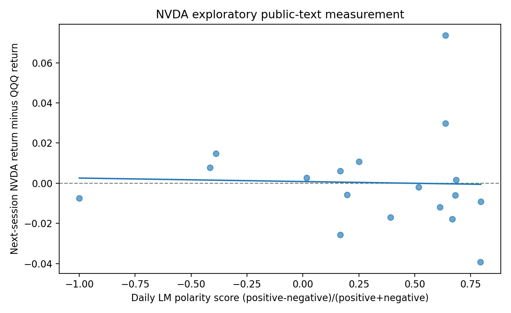

# News2Market research report — v3.1 workbench and historical v2 evidence

## v3.1 scope and research status

The current one-stop **English local dashboard** selects NVIDIA (NVDA), Apple (AAPL) or Google/Alphabet Class A (GOOGL). The **same codepath** handles validated Nasdaq CSV input for the selected equity and QQQ, issuer and third-party RSS/news collection, official LM dictionary scores, optional local Ollama Qwen2.5 1.5B audit labels and exploratory alignment with later price returns. Full online coverage and empirical findings for **all three** have **not** been established. The current v2 NVIDIA result below must not be generalized to Apple or Alphabet.

**Practical constraints:** The project was developed on a personal computer using zero-paid-API resources. The official LM dictionary is not bundled because use permissions do not automatically confer redistribution rights. A v3.1 startup preflight now detects a missing dictionary and attempts safe reuse from an existing local sibling installation before any news crawl. Nasdaq data still require user-authorized downloaded CSVs. Hardware limits restrict local language-model scale, while feed availability, day-level timing, sparse labels and lack of human ground truth limit research conclusions. More licensed data, compute and validation could support larger-scale research, but no gains are claimed before testing.

---

## Historical v2 NVIDIA issuer-news pilot (preserved)

# News2Market — Exploratory Research Report

**Pilot completed:** 2026-11-05  
**Objective:** Investigate finance-specific text measurement, low-resource local LLM reliability, and a small equity-return association using real but constrained sources.

## Dataset and measurements

**Issuer news:** 30 real NVIDIA Newsroom press releases from the configured historical period, not randomly sampled. LM polarity is defined as `(LM-positive - LM-negative) / (LM-positive + LM-negative)` when at least one polarity word matches; otherwise the score is missing. This is a text statistic, not a causal economic-shock measure. Source-specific NVIDIA boilerplate was removed in a separate, auditable cleaned-text field, never from the original captured text.

**Market data:** User-supplied 2021-11-05 through 2026-11-04 NVDA and QQQ CSV closing prices (1,254 matched sessions). `Close/Last` is not a dividend-adjusted total return. Signals were aligned conservatively to later close-to-close price returns given the lack of independently verified release timestamps. No industry/risk factor model, tradability analysis, nor holdout validation was performed.

## Exploratory regression — issuer news only

| Quantity | Observed |
|---|---:|
| News articles | 30 |
| Articles with LM polarity hits | 29 |
| Signal trading days in OLS | 18 |
| Pearson correlation | −0.0353 |
| LM sentiment coefficient | −0.001736 |
| HC1 standard error | 0.009859 |
| Exploratory p-value | 0.8602 |
| R² | 0.001246 |

**Interpretation:** No evidence of a simple linear association in this small observational pilot. The near-zero correlation is not proof of no relationship in general. The quoted standard errors are HC1 rather than autocorrelation-robust, and outcomes are NVDA minus QQQ raw price returns (not risk-adjusted abnormal returns). **Do not claim causal identification or forecast alpha.**

## Local LLM audit (Qwen2.5:1.5b)

Thirty articles were processed under a constrained JSON schema and evidence-ID mechanism. **Nine** final labels passed format plus exact-source-span checks, **three** needed manual review, and **eighteen** failed. A common failure was out-of-range `sentiment_score=4` despite a stated valid range of [−1,+1]. `economic_channel` also frequently collapsed to `Investor_Relations`, even for technology and investment stories. Some extracted evidence spans were truncated.

These are failure types, not hidden samples. Do not truncate invalid scores to +1. A source-matched quote is **not** verification of its economic interpretation. The small-model system is an auditable measurement pilot, not a reliable high-stakes classifier.

Ten texts received AI-assisted reference annotations. They are not independent blinded human annotations, so any agreement with these references is **descriptive only**, not an unbiased estimate of human-ground-truth accuracy.

## Independent external news discovery and LM

On 2026-11-05, the automated RSS pipeline attempted eight feeds; six were reachable and parsed, while Google News timed out and Bing News redirected. It deduplicated provider results to two relevant publisher stories. Both publisher bodies passed the project's extraction and eligibility checks, and both received LM polarity matches. This is an observed single-run success, not evidence of comprehensive coverage.

| Date (day-level only) | Publisher | Topic | LM polarity | Cleaned polarity |
|---|---|---|---:|---:|
| 2026-11-05 | TechCrunch | Box adopts NVIDIA Nemotron for retrieval | 0.142857 | 0.142857 |
| 2026-11-05 | CNBC | Moonshot and NVIDIA Blackwell infrastructure amid restrictions | 0.500000 | 0.500000 |

**Caution:** News RSS and publisher dates do not verify the first market-available instant. This external batch is **not** merged into the historical return regression, and its scores are **not** evidence of a positive stock-price response. The `lm_raw_sentiment` label of `neutral` for the +0.142857 TechCrunch article is the program's categorization; it should not be reinterpreted as a validated human assessment.

## What the pilot demonstrates

* Engineering ability: multi-source RSS discovery, error handling, accessible publisher extraction, deduplication, modular data stages, run isolation and audit outputs.
* Research caution: separate technical success from measurement validity; distinguish issuer PR from third-party journalism; leave invalid model outputs missing; record non-significant empirical results rather than optimizing them away.
* Potential follow-up: blind independent human labels, balanced event coverage, source-and-time-aligned event studies, adjusted market returns, temporal holdout data and factor-adjusted models.

**Status:** Research/engineering prototype, not peer-reviewed, no independent human ground truth and no demonstrated return predictability.
